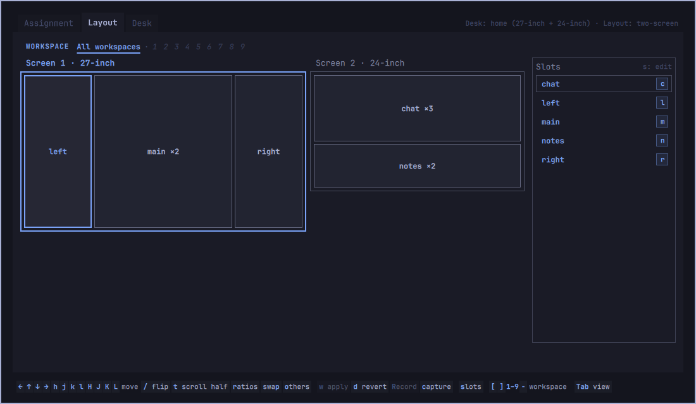
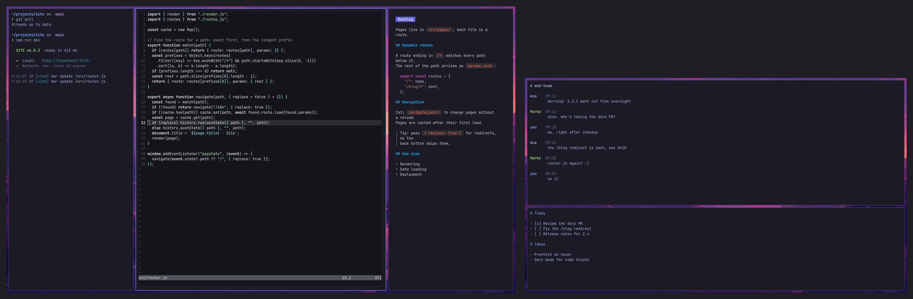
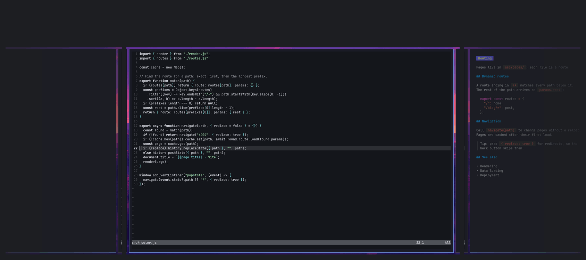
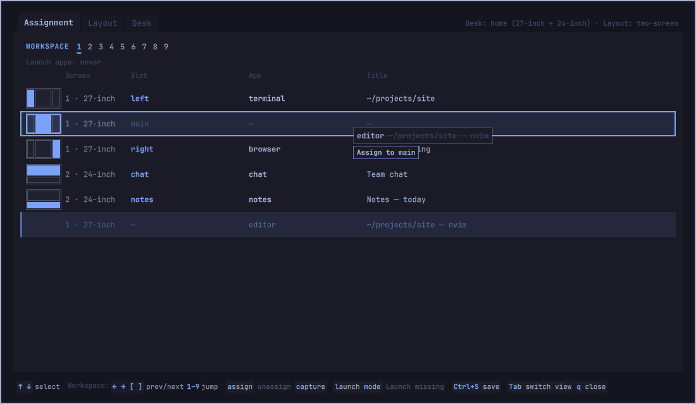
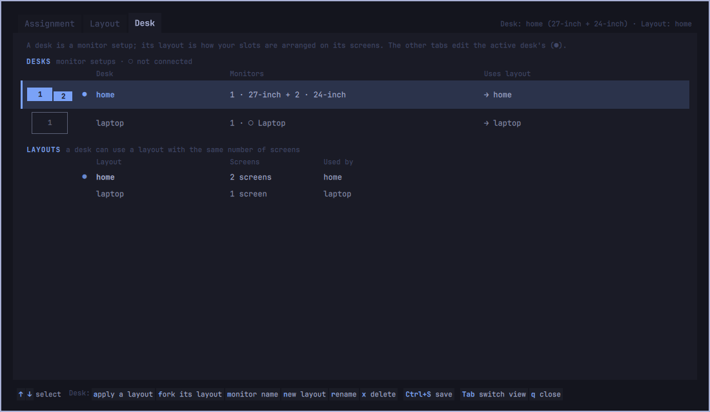
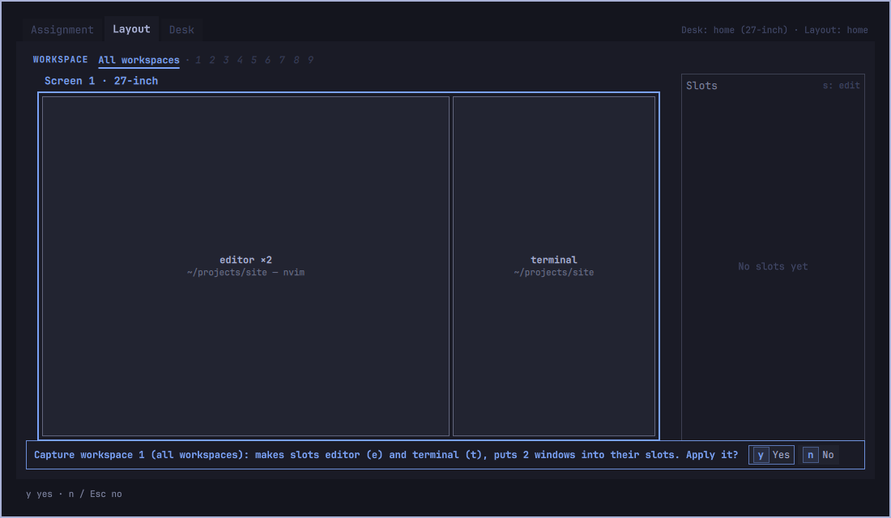

# hyprslots

**Name your slots once — every app finds its place on every workspace, on every screen, at every desk you plug into.**

<picture>
  <source media="(prefers-color-scheme: light)" srcset="docs/screenshots/layout-tab-light.png">
  
</picture>

*The editor's Layout tab: slots `left`, `main` and `right` on screen 1, `chat` and `notes` on screen 2,
shared by every workspace.*

## Why

At my desk I have big monitors, and I use the room: a terminal on the left, the editor in the middle,
docs on the right, chat and notes on the second screen. On the laptop alone the same apps sit in
full-width scrolling columns, one at a time. Every other monitor setup lays them out its own way again.

<table>
  <tr>
    <td><br>
      <em>At the desk: tiles across two monitors</em></td>
    <td><br>
      <em>On the laptop: the same slots as scrolling columns</em></td>
  </tr>
</table>

The slots are the same on every desk; only their arrangement changes. Keeping all of that in sync as
I switch desks back and forth is what hyprslots does: plug in or unplug, and every workspace has the
right apps in the right places on whichever desk I am at, without redoing anything.

## The idea in 4 concepts

hyprslots is a window layout plugin for [Omarchy](https://omarchy.org) (Hyprland). You set up these
four once, in an editor in Omarchy's shell; from then on every window you open goes straight to its
place.

**Slots** are named places on your screens: `left`, `main`, `right`, `notes`… You choose the names
and how many. The same slots exist on every workspace.

**Layouts** say how the slots are arranged on your screens: tiles side by side or stacked, with
exact ratios (`main` twice as wide as `right`), or scrolling columns, half or full screen wide. All
workspaces share one layout; a workspace that needs another arrangement gets its own. A slot that
nothing fills on a workspace takes no room there.

**Assignments** say which app fills which slot on each workspace. Windows go there by themselves
when they open, even when you open them on another workspace.



*The Assignment tab: drag a window onto its slot (or select it and press `a`).*

**Desks** are your monitor setups: the laptop alone, docked with an ultrawide, the office… hyprslots
recognises the one you are at from the monitors connected, and each desk uses a layout made for its
number of screens (two desks can share one). Super+1–9 switch every screen together: workspace 3
shows on all of them at once, each screen with its part of the layout.



*The Desk tab: each desk drawn as its monitors stand, the one you are at marked ●.*

## Install

1. Add the plugin:

   ```sh
   omarchy plugin add https://github.com/milanmitrovic/hyprslots --enable
   ```

   Omarchy asks you to confirm that you trust the plugin, then which bar section gets its widget
   (**right** is preselected). It lands in `~/.config/omarchy/plugins/io.github.milanmitrovic.hyprslots`.

2. Enable the engine. Click the bar widget (it shows **enable**). The editor asks **Enable the
   hyprslots engine?** **Enable** (`e`) adds one file, `zz-hyprslots.lua`, to Omarchy's
   workspace-layouts folder (`~/.local/state/omarchy/workspace-layouts`, which Omarchy loads along
   with its own saved workspace layouts) and reloads Hyprland. Your Hyprland config is not edited;
   the engine takes over Super+1–9 and Omarchy's resize keys from that file. Two choices sit under
   the text, in this order:

   - **Also bind Super+Ctrl+Y to open the editor and Super+Ctrl+Shift+C to capture** (`k`, off):
     each key only where nothing else uses it.
   - **Add hyprslots to the Omarchy menu** (`m`, on): *hyprslots: Open editor*, *Capture this
     workspace* and *Launch missing apps* under Trigger, written between marker lines in
     `~/.config/omarchy/extensions/omarchy-menu.jsonc`.

   Nothing is written until you press Enable. From a terminal instead (run it again later to change
   the keys or the menu; `--no-keys` and `--no-menu` take them away, `--no-reload` skips the reload):

   ```sh
   ~/.config/omarchy/plugins/io.github.milanmitrovic.hyprslots/tools/install-engine.sh --keys --menu
   ```

## Quick start: your first layout in 2 minutes

Once the engine runs, the bar widget shows **set up** and the editor opens on the **Layout** tab,
which says **Start with your slots**. Pick one of two ways.

**A. Capture what you already have**

1. On a workspace, open your apps and tile them the way you like, on every screen.
2. Open the editor (click the bar widget).
3. Press `c` (**Capture my windows**).
4. Choose `a` (all workspaces share this arrangement) or `o` (only this workspace).
5. Check the preview: each window becomes a slot named after its app (rename it later), and the
   picture shows the arrangement. Press `y`.

   

6. **Ctrl+S** saves.

**B. Start from scratch**

1. **Layout** tab: press `a` (**Create your first slot**), type a name such as `main`, Enter, then
   an optional description (Enter skips it).
2. More slots: `s` opens the slot list, `a` adds one (`left`, `right`…), Esc goes back to the
   picture. A new slot goes to the end of screen 1.
3. Arrange them: drag a slot onto another (its middle swaps them, an edge puts it beside) or onto
   another screen; drag the dividers between slots for the ratios; `t` turns a screen into
   scrolling columns (half, then full width) and back into tiles.
4. Press Tab until the **Assignment** tab shows, and pick a workspace (`1`–`9`, or ←/→). Drag each
   window onto its slot's row, or select it and press `a`, then the slot's letter.
5. **Ctrl+S** saves.

Now close one of those apps and open it again: it lands in its slot, on its workspace.

## Everyday use

**Opening the editor**: click the bar widget; or the Omarchy menu, Trigger, *hyprslots: Open editor*;
or Super+Ctrl+Y if you bound it. Right-click the widget for **Re-apply layout**, **Record workspace
N…**, **Capture this workspace…**, **Save** and **Reload config**. A dot after the layout's name in
the bar means unsaved edits.

**The editor**: Tab / Shift+Tab switch tabs, **Ctrl+S** saves, Esc or `q` closes. Every key is also a
button in the toolbar along the bottom, and edits stay unsaved until Ctrl+S.

- **Assignment**: one workspace's slots and windows. `a` or a drag onto a slot assigns, `u` or a
  drag onto the other windows unassigns, `m` sets when the workspace launches its missing apps,
  `L` launches them now, `c` captures.
- **Layout**: a picture of each screen. The strip on top picks **All workspaces** (the shared
  layout) or one workspace (`3•` means workspace 3 has its own; `u` goes back to the shared one).
  Drag slots and dividers, or use `hjkl` to move, `t` tiles/scroll, `r` ratios, `p` swap screens
  (or drag a screen by its title), `/` flip; `s` is the slot list (`a` add, `r` rename, `e`
  describe, `K` its key, `d` delete).
- **Desk**: your monitor setups and the layouts. On a desk, `a` picks its layout, `f` forks it (so
  a change stays on this desk), `m` names a monitor; `n` makes a new layout, `r` renames, `x`
  deletes.

**Switching workspaces**: Super+1–9 show that workspace on every screen at once, and the keyboard
stays on the screen you were on. Each screen keeps Omarchy's own numbering: workspace 3 is 3 on
screen 1 and 13 on screen 2.

**Resizing**: Omarchy's resize keys (Super+Minus and Super+Equal, with Shift for height, Alt or
Ctrl for smaller or bigger steps) resize the focused window's slot. Such a change lasts until
Hyprland reloads; Ctrl+S in the editor keeps it. In the editor, drag the dividers.

**Launching missing apps**: on the Assignment tab, `m` sets each workspace to *never* (the default),
*on demand* or *at login*. `L`, or *hyprslots: Launch missing apps* in the Omarchy menu, opens the
apps the workspace's empty slots wait for, each onto its workspace and into its slot; *at login*
also does so when Hyprland starts. The command comes from the app's desktop entry; a slot for one
particular window (a terminal in a project folder) needs a command in `config.lua` (below).

**Docking and undocking**: plug a monitor in or out and hyprslots picks the desk for what is now
connected and puts every window into its slot on that desk's layout. A monitor setup it has not
seen gets a desk of its own after a second, using the layout you last used for as many screens,
and a notification says so; change it in the **Desk** tab, and Ctrl+S keeps the new desk.

## Requirements and compatibility

- **Omarchy 4.5** or later (tested on 4.5.0): its shell hosts the editor and the bar widget.
- **Hyprland 0.56** or later (tested on 0.56.2) with its **Lua config** (`hyprland.lua`), as
  Omarchy 4.5 sets it up. `hyprland.lua` must still require `default.hypr.toggles`, as Omarchy's
  does: that is what loads the workspace-layouts folder.
- **hyprmoncfg**: set its **workspace planner to Off**, in every profile. The planner replaces
  Omarchy's per-screen workspace numbers with global ones, which hyprslots builds on; while it is
  on, hyprslots stays off (the bar says **off**). hyprmoncfg keeps managing your monitors' modes
  and positions.
- Anything else that rebinds Super+1–9 or Omarchy's resize keys, or sets workspace layouts, will
  fight hyprslots over them.
- **Super+L**: Omarchy's layout cycle (tiling, scrolling, floating) does not know slots. Its first
  press takes the workspace out of slots, and the cycle never comes back to them. To bring slots
  back to workspace N, press Super+L until the workspace is in Omarchy's default layout (or
  `rm ~/.local/state/omarchy/workspace-layouts/N.lua`), then `hyprctl reload`.
  `contrib/super-l/` holds patches for a cycle with a slots stop, as a starting point for your own.

## The configuration files

Both live in `~/.config/hyprslots/`, written on the first start:

- `slots.lua` is the editor's: your slots, assignments, desks and layouts. Ctrl+S rewrites it, so
  leave it to the editor.
- `config.lua` is yours: real Lua, commented, never written again. It passes `slots.lua` on to
  hyprslots, and anything you set in it wins over the editor (which then shows it read-only).

Most people never touch `config.lua`. Reach for it to give a slot a launch command, to tell apart
windows of one app by their title, or to branch on the machine (`hostname()`). Add lines inside
its `return { … }` and reload Hyprland:

```lua
  -- the command Launch missing apps uses for the kitty window titled "deltaf | …"
  launch_commands = { ["kitty/deltaf"] = "kitty --directory ~/Projects/deltaf" },
  -- tell Ghostty windows apart by what their title says before " | "
  -- (kitty, foot and Alacritty work so already)
  title_matching = { extractors = { ["com.mitchellh.ghostty"] = " | " } },
```

## Uninstall

1. Disable the engine: this removes `zz-hyprslots.lua`, the editor's keys and the Omarchy menu
   entries, and reloads Hyprland, which brings back Omarchy's own Super+1–9 and resize keys.

   ```sh
   ~/.config/omarchy/plugins/io.github.milanmitrovic.hyprslots/tools/uninstall-engine.sh
   ```

2. Remove the plugin (the editor and the bar widget):

   ```sh
   omarchy plugin remove io.github.milanmitrovic.hyprslots
   ```

   Removing the plugin first is fine too: the loader then removes itself and the menu entries as
   soon as Hyprland reloads, which happens right away.

3. Optionally, your configuration: `rm -r ~/.config/hyprslots`.

## Troubleshooting

- **The bar shows "enable", or is red.** *enable*: the engine is not enabled; click it (Install,
  step 2). Red: hover it for the reason. *off* means hyprmoncfg's workspace planner is on; a config
  error names the line to fix in `config.lua`, then right-click, **Reload config**; if the engine
  failed to load, the editor shows the error and **Try again**.
- **My only screen shows workspaces 11–19.** Omarchy numbers each monitor's workspaces by the order
  it first saw them. While a desk is active hyprslots gives screen 1 workspaces 1–10 again, so this
  means the engine is not running (see above) or no desk is active yet (wait a second after
  plugging in).
- **A window does not go to its slot.** On the Assignment tab, compare the window's **App** and
  **Title** with what the slot waits for (its red *Missing* row). An app whose title changes, or
  two windows of one app, may need a title rule (above). Select the window and press `a` to assign
  it as it is now.
- **What is hyprslots doing?** `hyprctl repl 'return hyprslots.dump()'` prints its state and log.

## Development

`make test` runs the Lua specs (busted), the editor's JavaScript (node) and QML (Qt 6
qmltestrunner); `make editor-lint` lints the QML; `make e2e` and `make e2e-editor` run against a
nested Hyprland. [docs/design.md](docs/design.md) describes everything in detail. For a development
install, link `~/.config/omarchy/plugins/io.github.milanmitrovic.hyprslots` to your checkout and run
`tools/install-engine.sh`.

## License

MIT, see [LICENSE](LICENSE).
